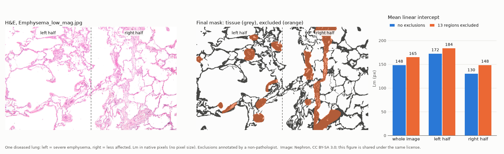

# Lung MLI pipeline

A pipeline that measures mean linear intercept (Lm) on H&E lung histology,
validated on synthetic images with known Lm and against hand traces, and
demonstrated on one emphysema image (`Emphysema_low_mag.jpg`, Wikimedia
Commons). What the validation does and does not cover is set out under
[Results](#results) and [Limitations](#limitations).

The image shows one diseased lung: severe emphysema on the left and less
affected tissue on the right. **The left/right difference reported here is
variation within one emphysematous lung, not a healthy-vs-emphysema
comparison.** The image has no stated pixel size, so all lengths are in native
pixels (px).

Sources and licenses are in `data/raw/commons/ATTRIBUTION.md`. The raw images
are not in this repository; download them from the URLs listed there into
`data/raw/commons/` to rerun the pipeline. Licensing is summarised under
[Licensing](#licensing).



## Pipeline

| Step | Script | What it does |
|---|---|---|
| 1. Tissue vs airspace | `src/segment.py` | Half-max edges (frac 0.5); fills dense holes; drops free pieces < 300 px |
| 2. Exclusions | `src/exclude.py` | Removes vessels, airways and connective bundles (criteria below) from the measured region |
| 3. Line counting | `src/mli.py` | Lm = L / (T/2) on horizontal and vertical test lines every 8 px; min_tissue = 3 px; lines are split at excluded regions |

Run on the development image:

```
python3 -I src/segment.py data/raw/commons/Emphysema_low_mag.jpg outputs/segmentation
python3 -I src/exclude.py data/raw/commons/Emphysema_low_mag.jpg data/annotations/Emphysema_low_mag_exclude.json outputs/exclusion
python3 -I src/real_sweep.py data/raw/commons/Emphysema_low_mag.jpg outputs/real/threshold_sweep.csv outputs/exclusion/Emphysema_low_mag_valid.png
python3 -I src/summary_figure.py data/raw/commons/Emphysema_low_mag.jpg outputs/exclusion outputs/summary.png
```

Validation:

```
python3 -I src/validate_synthetic.py outputs/synthetic outputs/real/render_profile_calibrated.json
python3 -I src/compare_walls.py data/raw/commons/Emphysema_low_mag.jpg outputs/real/traces outputs/real/walls_only
```

## Results

### Lm on the development image

From `outputs/exclusion/exclusion_lm.csv`. Lengths are in px; the left half is the severely emphysematous side.

| Exclusions | Whole | Left half | Right half | Left / right | Area excluded |
|---|---|---|---|---|---|
| none | 148.4 | 172.5 | 130.3 | 1.32 | 0% |
| all 13 regions | **164.8** | **183.8** | **148.5** | **1.24** | 9.4% |
| all except the 2 low-confidence regions | 163.1 | 181.5 | 147.2 | 1.23 | 8.7% |

### Synthetic validation (`src/validate_synthetic.py`, `outputs/synthetic/results.csv`)

**Line counting.** The counting step was tested on 24 synthetic masks with exactly known geometry: grids, Voronoi foams with walls 3–8 px, foams with missing walls, and a partial measured region.
- The crossing count equals the pixel-level truth in 24 of 24.
- Lm differs from the continuous geometry by 0.0 to +1.2%, which comes from pixelation.

**Full pipeline on calibrated renders.** Synthetic images were rendered to match the real image's stain density (median tissue OD 0.42 vs 0.43), its unevenness, and its edge blur (σ 1.76 vs 1.75 px). The pipeline then ran on them end to end:

| Airspace size (true Lm, px) | Lm error, final method | Lm error, first global threshold | Wall thickening, final method (px/side) |
|---|---|---|---|
| 24 | +14.9% | +33.0% | +0.90 |
| 46 | +5.2% | +13.2% | +0.78 |
| 88 | +2.0% | +6.3% | +0.58 |
| 170 | **+1.4%** | +2.9% | +0.58 |
| 69 (walls 3–12 px) | +2.9% | +8.5% | +0.57 |

The 2% tolerance is met only for the largest airspaces. Lm on the development image (148–185 px) falls in that range.

**Clean-up rules.** Short-run removal and pinhole filling were tested on synthetic artifacts. Pinhole filling biased Lm by about +2%, so it is off.

### Agreement with hand traces (`src/compare_walls.py`, `outputs/real/walls_only/`)

Three 200 × 200 px crops were traced by hand (A and C from the right half, B from the left). Free cells were removed from both the traces and the automatic mask by the same rule. With the final method:

| Crop | Edge offset (px/side) | Dice | Lm, auto vs trace |
|---|---|---|---|
| A | +0.27 | 0.95 | −2.3% |
| B | +0.53 | 0.94 | −1.2% |
| C | +0.06 | 0.95 | 0.0% |
| pooled | **+0.28** | | **−0.9%** |

The first global threshold placed edges 1.7–2.1 px/side outside the traced walls.

### Sensitivity to the edge fraction

The edge fraction sets where each wall edge sits: the fraction of the local tissue level at which stain density is cut. The table combines `outputs/real/threshold_sweep.csv` (low threshold 0.10) with the trace comparison.

| Edge fraction | Whole, no exclusions | Whole, with exclusions | Left / right, with exclusions | Lm vs traces (walls only, pooled) |
|---|---|---|---|---|
| 0.4 | 155.6 | 168.8 | 1.24 | |
| **0.5** | **148.4** | **164.8** | **1.24** | **−0.9%** |
| 0.55 | | | | −2.6% |
| 0.6 | 142.9 | 162.1 | 1.20 | −4.5% |
| 0.7 | 132.2 | 154.9 | 1.18 | |

- **0.5 to 0.6:** with exclusions, Lm falls by 1.6%. Without them, it falls by 3.7%.
- **0.6 and above:** cellular walls start to split, which adds false crossings. This is why 0.5 was chosen.
- **Low threshold (0.05–0.20, at 0.5):** with exclusions, Lm ranges from 161.0 to 169.3.

## Segmentation choices (step 1)

- **Edges.** Each wall edge is placed where stain density crosses half the local tissue level (frac 0.5), chosen against the hand traces above.
- **Dense holes.** Enclosed holes whose density never drops to airspace level (OD ≤ background + 0.10) are filled. They are pale tissue, not air, such as the pale core of a junction.
- **Free pieces.** Isolated pieces smaller than 300 px are removed as free cells (alveolar macrophages and similar), which are not septa. Pieces touching the image edge are kept. The traced free cells measure 34–207 px in the automatic mask, so 300 px leaves margin. Size alone misclassifies a few long detached wall fragments and a few large round cells (`outputs/real/walls_only/small_pieces.png`).

## Exclusion criteria (step 2)

Lm describes alveolar parenchyma, so structures that are not alveolar septa are removed from the measured region. Test-line length and air/tissue transitions inside them are not counted. A structure is excluded if it meets **any** of V, A or C, and is not covered by "Not excluded".

**V. Vessel.** Any of the following:
1. A lumen bounded by a wall clearly thicker than the adjacent septa (smooth-muscle and/or adventitial layers), with or without red cells.
2. Red cells packed in a channel wider than a capillary (more than about 15 px) that has its own wall.
3. A round or oval mass with concentric spindle-cell layers and no alveolar lining. This is a vessel cut obliquely or with a collapsed lumen.

Capillaries inside septa of normal thickness are **not** vessels for this rule, even when they contain red cells.

**A. Airway.** A lumen lined by cuboidal or columnar epithelium, with a wall of smooth muscle and/or connective tissue (bronchi, bronchioles). None was found in `Emphysema_low_mag.jpg`.

**C. Connective bundle.** A band or mass of connective tissue (eosinophilic fibres, spindle nuclei, little or no alveolar lining) whose solid width exceeds **30 px** along at least **100 px**. 30 px is 2.5× the median hand-traced septal width of 12 px. Examples are bronchovascular sheaths, interlobular septa, pleura and fibrous scars. Loose, lacy connective tissue continuous with such a bundle is part of it.

**Not excluded:**
- thickened septa that separate two airspaces and are lined on both sides
- septal junctions
- free cells and red cells or exudate inside airspaces (handled by the free-piece rule)
- lumen-free tissue that fails the C size test

**Boundary.** The outer edge of the structure, including its lumen and adventitia. Where septa join it, the boundary cuts across them at the structure's outer surface. Polygons in `data/annotations/<image>_exclude.json` are drawn loosely, with their edge in the adjacent airspace. `src/exclude.py` tightens each one to the structure: polygon ∩ the closed, hole-filled tissue inside it, plus 6 px.

**Confidence.** Each region records the criterion it meets and the annotator's confidence:
- **high:** the criterion is clearly met
- **medium:** met, but another reading is possible
- **low:** doubtful

Lm is reported both with and without low-confidence regions.

The pixel thresholds (30 px, 100 px, 15 px) apply to images at this magnification. Rescale them when a pixel size is known.

### Applied to `Emphysema_low_mag.jpg`

Drawn on 2026-11-14 and reviewed by the author the same day. The figures are `outputs/exclusion/*_overlay.png` and `*_zoom.png`.

**Annotator caveat.** These exclusions were annotated by a non-pathologist (Claude, from the image alone), then reviewed by the author. Vessel and airway calls, especially those without a visible lumen, are interpretations a pathologist should confirm before the results are relied on. The confidence column records how uncertain each call is.

| Region | Criterion | Confidence |
|---|---|---|
| Connective band (bronchovascular sheath, x ≈ 2240–2690, full height) | C | high |
| Vessel, bottom right (2560, 1740) | V1 | high |
| Vessel (2100, 650), with its cellular segment down to y ≈ 1010 | V1, V2 | high |
| Vessel (1000, 480) | V1 | high |
| Vessel (1200, 1500) | V3 | medium |
| Vessel (1200, 1750) | V3 | medium |
| Small vessel (1090, 195) | V1 | medium |
| Small vessel (45, 610), image edge | V1 | medium |
| Vessel (2125, 1445): no visible lumen or clear concentric layers, may be a thick septal junction (downgraded at the author's review) | V3? | low |
| Fibrous loop (1400, 1120) | C | high |
| Fibrous band (620, 1560) | C | high |
| Fibrous nodule (455, 1505) | C | medium |
| Cellular mass (1535, 370) | C | low |

**Considered and not excluded:**
- red-cell-rich septal region at the right edge (3200, 840): no walled channel
- red cells free in airspaces at (3250, 570) and (1230, 720)
- the lacy region x ≈ 1800–2100, y ≈ 1450–1979: its strands are septum-thin and it is not continuous with a bundle
- hyalinised septal tips and pleats under 30 px wide, e.g. (260, 300), (500, 95), (860, 1300)

## Limitations

- **Pixel units only.** The image has no pixel size, so Lm is in px. It cannot be compared with published values in µm or across images at other magnifications. Every pixel threshold (free-piece size, exclusion widths) is tied to this magnification.
- **A single image.** One section from one diseased lung, with no healthy control. The left/right contrast is within-lung variation, and no subject-level statistics are possible. Other stains, scanners and magnifications are untested.
- **Small-airspace bias.** On calibrated synthetic images, Lm is overestimated by +2% at 88 px, +5% at 46 px and +15% at 24 px. Two causes:
  - blur closes the corners where walls meet
  - walls remain about 0.6–0.9 px/side too thick

  Airspaces in this image (Lm 148–185 px) are in the range where the error is about +1.4%. Normal lung imaged at the same magnification would have smaller airspaces, so its Lm would be overestimated more, which would shrink a healthy-vs-emphysema difference. The synthetic renders match the real image's stain statistics but lack nuclei and internal wall structure.
- **Hand-drawn exclusions.** The 13 regions were outlined by a non-pathologist and reviewed by the author, with no pathologist review. Calls without a visible lumen are the most uncertain. Boundaries where structures meet septa are judgment calls.
- **32% of tissue excluded.** The excluded regions cover 9.4% of the image but 32% of all tissue. Results depend strongly on them: whole-image Lm rises from 148.4 to 164.8 px (+11%), and the left/right ratio falls from 1.32 to 1.24.

Hand-trace agreement rests on three 200 px crops traced by one person. Pooled Lm from three crops is good to only a few percent.

## Licensing

- **Code** (`src/`): MIT, see `LICENSE`.
- **Image-derived files: CC BY-SA 3.0.** Each is an adaptation of `Emphysema_low_mag.jpg` by Nephron (Wikimedia Commons, CC BY-SA 3.0), so it is shared under the same license, with attribution to Nephron:
  - `outputs/summary.png`
  - the hand traces `outputs/real/traces/trace_A.png`, `trace_B.png` and `trace_C.png`: red wall tracings painted by the author directly over 200 × 200 px crops of the image, shown at 4×
  - the exclusion outlines in `data/annotations/`, drawn on the same image
- **Hand-trace crop positions** (x, y, size in native px) are in `src/crops.py`: A (2700, 1000, 200), B (450, 680, 200), C (2900, 1200, 200).

## Authorship

The code was written with Claude Code. The author directed the analysis, hand-traced the validation crops and made the method decisions.
